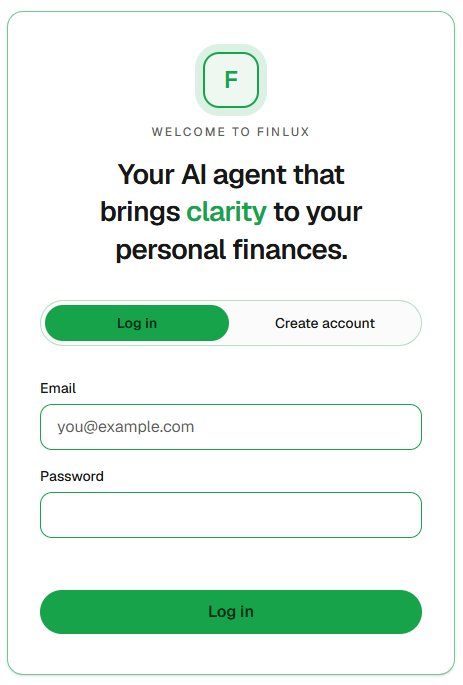
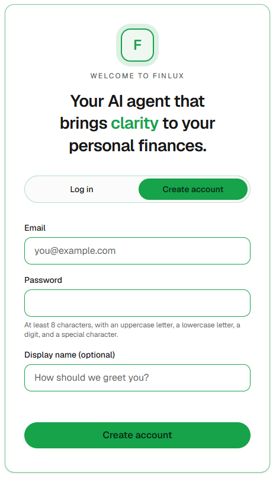
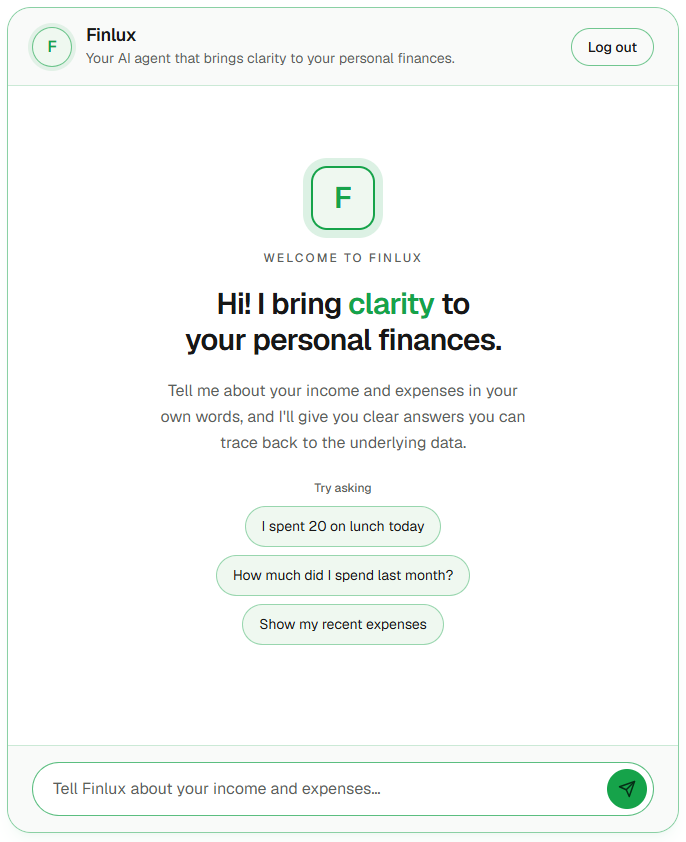

# Finlux

Finlux is not a passive dashboard — it is an **AI agent** you talk to. You
record income and expenses in natural language, ask questions about your money,
and the agent reasons over **your own data** to answer, always grounded in what
you actually recorded. It never moves real money and never gives regulated
financial advice; it brings clarity, not risk.







---

## Table of contents
- [What Finlux does](#what-finlux-does)
- [Agentic architecture](#agentic-architecture)
  - [The turn, end to end](#the-turn-end-to-end)
  - [The MCP tool boundary](#the-mcp-tool-boundary)
  - [Token-handling security](#token-handling-security)
  - [Guardrails and non-goals](#guardrails-and-non-goals)
- [System overview](#system-overview)
- [Tech stack](#tech-stack)
- [Repository layout](#repository-layout)
- [Data model](#data-model)
- [Security](#security)
- [Getting started](#getting-started)
- [Configuration](#configuration)
- [Common commands](#common-commands)
- [Deployment](#deployment)
- [How this project is built: specs](#how-this-project-is-built-specs)
- [Contributing](#contributing)
- [Reporting security issues](#reporting-security-issues)
- [License](#license)

---

## What Finlux does
- **Record transactions in natural language** — e.g. "I spent 20 on lunch
  today". The agent extracts a structured draft (amount, type, currency, date,
  description, suggested category) and only saves it **after you confirm**.
- **Conversational Q&A over your finances** — e.g. "how much did I spend on food
  last month?". Every figure comes from a tool call over your stored data, so
  answers are traceable, not invented.
- **Automatic categorization** at capture time, which you can accept or correct.
- **Multiple items at once** are recorded **one by one**, and the agent checks
  for a same-concept transaction already recorded that month before adding a
  possible duplicate.
- **Speaks your language**: Spanish by default, English when you write in
  English; defaults the currency to COP (Spanish) or USD (English) unless you
  say otherwise.

Finlux is conversation-first with a focused chat UI, and treats all financial
data as sensitive PII.

---

## Agentic architecture

The heart of Finlux is a **tool-using LLM agent** orchestrated by
[Mastra](https://mastra.ai/) with a **Google Gemini** model (via the
`@ai-sdk/google` provider). The agent reasons over the user's finances **only
through tools** — it has **no direct database access** to transactions. Those
tools are exposed by an **in-process MCP (Model Context Protocol) server** whose
handlers are **HTTP clients of the transaction REST API**, forwarding the
caller's JWT so the API remains the single authority on who owns what.

### The turn, end to end

```
Browser (Next.js chat)
  │  POST /conversations  or  /conversations/:id/messages   (Authorization: Bearer <JWT>)
  ▼
ChatController ──► ChatService ──► ConversationService  ── persists user + agent turns (TypeORM)
                        │                                   (messages.content encrypted at rest)
                        ▼
                  AgentService.runTurn(userId, jwt, messages)
                        │   builds a server-side RequestContext { userId, accessToken }
                        ▼
                  Finlux Mastra Agent  (Gemini model + system prompt + tools)
                        │   decides which tool(s) to call
                        ▼
                  In-process MCP tools  (list / get / create / update / delete /
                        │                summarize transactions, get-current-date)
                        ▼
                  TransactionApiClient  ──HTTP──►  GET/POST/PUT/DELETE /transactions
                        with Authorization: Bearer <caller JWT>        │
                                                                       ▼
                                      TransactionsController ─► TransactionsService ─► PostgreSQL
                        ◄── grounded tool results (decrypted, user-scoped) ──┘
                        ▼
                  Agent composes a grounded, plain-text reply
                        ▼
ChatService persists the agent turn and returns { conversation, messages }
  ▲
Browser renders the live conversation
```

### The MCP tool boundary
- **Why MCP, in-process.** The agent's transaction capabilities are declared as
  MCP tools on an in-process MCP server mounted inside the NestJS backend (one
  deployment). This keeps the toolset a clean, auditable **allowlist** and keeps
  the agent decoupled from persistence.
- **No direct DB access.** Tool handlers do **not** inject `TransactionsService`
  or a repository. They call the **transaction HTTP API** (`/transactions`) as a
  client. So every read/write the agent performs goes through the exact same
  authenticated, user-scoped REST surface a normal client would use.
- **The API is the ownership authority.** Each tool forwards the caller's JWT as
  `Authorization: Bearer`; the API resolves the owner from that token
  (`@CurrentUser('userId')`) and scopes every query to that user. The agent
  cannot reach another user's data even if the model tried.
- **Tools available to the agent:** `list-transactions`, `get-transaction`,
  `create-transaction` (the only write path, gated behind explicit
  confirmation), `update-transaction`, `delete-transaction`,
  `summarize-transactions` (aggregates per currency, never across currencies),
  and `get-current-date` (resolves relative dates like "today").

### Token-handling security
The caller's JWT is a first-party credential; two layers protect it:

- **Layer 1 — the token never enters the model's domain.** The `userId` and JWT
  travel only via a server-side `RequestContext`; they are never a tool input
  field, never in a tool result, never in the system prompt, and never logged.
  An **egress guardrail** scrubs any JWT-shaped string from the agent's final
  reply as defense-in-depth.
- **Layer 3 — the token can only reach its destination.** The HTTP client builds
  every request from a configured base URL plus hard-coded path templates and
  validated params, and enforces a host allowlist before attaching the bearer
  header — so a bug or prompt injection can't exfiltrate the token to another
  host.

### Guardrails and non-goals
Encoded in the agent's system prompt and enforced structurally by the tool
allowlist:
- **No real-money movement** — there is no payment/transfer/bank tool; such
  requests are declined and explained.
- **No regulated advice** — the agent clarifies your own numbers; it declines
  tax/legal/investment advice.
- **Grounded only** — every quantitative claim comes from a tool result; if the
  data can't answer, the agent says so rather than fabricate.
- **Capture requires explicit confirmation** — a described-but-unconfirmed
  transaction is never saved.
- **Prompt-injection resistant** — message content is treated as data, not
  instructions.
- **Currency-explicit, no FX** — currencies are reported separately, never
  summed or converted.
- **Plain-text replies** — the chat renders text verbatim, so the agent emits no
  Markdown.

---

## System overview

Two independent apps in one monorepo:

- **Backend** (`backend/`) — NestJS API + the agentic layer. Feature modules:
  - `auth` — registration, login, JWT, route guard, `@CurrentUser`.
  - `users`, `transactions` — user-scoped persistence + the transaction REST API.
  - `chat` — conversation/message persistence and the chat endpoints.
  - `agent` — the Mastra/Gemini agent, system prompt, and egress guardrail.
  - `mcp` — the in-process MCP server, the transaction tools, and the HTTP
    `TransactionApiClient`.
  - `crypto` — at-rest field encryption (transformer + blind index).
  - `database` — TypeORM data source, modules, migrations, transformers.
- **Frontend** (`frontend/`) — Next.js (App Router) chat UI:
  - `components/chat` — chat shell, message list/bubbles, input, pending/typing
    indicator, error notice, welcome state.
  - `components/auth` — login/registration screen, logout, gated home route.
  - `lib/auth` — `AuthProvider`, shared authenticated API client (`authedFetch`,
    bearer token, global `401 → return to auth`), token storage.
  - `lib/chat` — `ChatProvider` + a typed `ChatApi` over the shared client.

---

## Tech stack

| Area | Choice |
|------|--------|
| Language | TypeScript (backend + frontend) |
| Runtime | Node.js 24.22.1 |
| Package manager | pnpm 12.15.0 (pinned; never npm/yarn) |
| Backend | NestJS 12 (ESM) |
| Database | PostgreSQL 18.6 |
| ORM | TypeORM (migrations; `synchronize: false`) |
| AI orchestration | Mastra (v1+) |
| LLM provider | Google Gemini via `@ai-sdk/google` |
| Agent tools | in-process MCP server (`@mastra/mcp`) + `zod` schemas |
| Auth | email + bcrypt, 1h JWT access token (passport-jwt) |
| Frontend | Next.js 16 (App Router), React 19, Tailwind CSS v4 |
| Tests | Vitest (unit + e2e), supertest, React Testing Library |

---

## Repository layout

```
finlux/
├── .kiro/                 # specs, steering (product/tech/structure), skills
│   ├── specs/             # per-feature requirements → design → tasks
│   ├── steering/          # persistent project rules & context
│   └── skills/            # reusable procedures (migrations, dev stack, UI design)
├── backend/               # NestJS API + agentic layer
│   └── src/{auth,users,transactions,chat,agent,mcp,crypto,database}
├── frontend/              # Next.js chat UI
│   └── src/{app,components/{chat,auth},lib/{auth,chat}}
├── docs/                  # assets (logo)
└── README.md
```

---

## Data model

Minimal and user-scoped. Table names are `snake_case` plural; schema is managed
by versioned TypeORM migrations.

- **`users`** — identity that anchors and isolates all data. Stores a bcrypt
  password hash; `email`/`display_name` are encrypted at rest; a deterministic
  `email_bidx` provides case-insensitive uniqueness and login lookup.
- **`transactions`** — a recorded income or expense owned by one user: precise
  `numeric(19,4)` `amount` (handled as a decimal **string**, never a float),
  `type` (`income`|`expense`), `currency` (`COP`|`USD`), `date`, and an
  encrypted `description`.
- **`sessions`** — audit-only login record (stores a SHA-256 hash of the issued
  JWT, never the raw token).
- **`conversations`** / **`messages`** — the agent's own chat memory; a
  message's `content` (both user and agent turns) is encrypted at rest.

---

## Security
- **Per-user isolation** everywhere: every transaction query is scoped by the
  authenticated `userId`; "not found" and "not owned" are indistinguishable
  (`404`) so other users' data is never disclosed.
- **Encryption at rest** of sensitive PII (`users.email`, `users.display_name`,
  `messages.content`, `transactions.description`) with AES-256-GCM via a
  transparent TypeORM transformer; the email uses an HMAC **blind index** for
  lookup/uniqueness without storing plaintext. Two separate keys
  (`ENCRYPTION_KEY`, `BIDX_KEY`), validated fail-fast at startup.
- **Credentials** stored only as bcrypt hashes; tokens/keys/plaintext PII are
  never logged.
- **Authentication** uses a stateless, access-only JWT (no refresh). Its
  lifetime is configurable via `JWT_EXPIRES_IN` — **5 minutes in production**
  (short-lived by design for a finance app), defaulting to 1h in local dev.
  Logout is client-side (the token is discarded); a `sessions` row stores only a
  SHA-256 hash of the issued token for audit.
- **Validation** via a global `ValidationPipe` (`whitelist` +
  `forbidNonWhitelisted`); parameterized access via TypeORM (no raw SQL on user
  input).
- Secrets come from the environment by key name and are never committed
  (`.env` is git-ignored; `.env.example` documents the keys).

---

## Getting started

### Prerequisites
- Node.js **24.22.1** and pnpm **12.15.0** (`corepack enable` to get pnpm).
- A running **PostgreSQL 18.x** with a `finlux` database. For local dev a Docker
  container named `postgres` exposing `5432` is assumed.
- A Google Generative AI API key (for the agent).

### 1. Install dependencies
```bash
pnpm --dir backend install
pnpm --dir frontend install
```

### 2. Configure environment
Copy the examples and fill in real values (never commit `.env`):
```bash
cp backend/.env.example backend/.env
# create frontend/.env with NEXT_PUBLIC_API_BASE_URL=http://localhost:8000
```
See [Configuration](#configuration) for the required keys.

### 3. Create the database schema
```bash
pnpm --dir backend migration:run
```

### 4. Run both apps (dev)
```bash
pnpm --dir backend start:dev   # NestJS on http://localhost:8000
pnpm --dir frontend dev        # Next.js on http://localhost:3000
```
Open http://localhost:3000, register, and start chatting with the agent.

> Tip: the `run-dev-stack` skill under `.kiro/skills/` documents the exact
> local wiring (ports, CORS, env) used for manual testing.

---

## Configuration

**Backend (`backend/.env`)** — see `backend/.env.example` for the full list:

| Key | Purpose |
|-----|---------|
| `PORT` | API port (default 8000) |
| `CORS_ORIGIN` | comma-separated allowlist of frontend origins |
| `DATABASE_URL` | PostgreSQL connection string |
| `JWT_SECRET`, `JWT_EXPIRES_IN` | JWT signing secret and lifetime (default 1h; **5m in production**) |
| `BCRYPT_SALT_ROUNDS` | bcrypt cost factor |
| `ENCRYPTION_KEY` | 32-byte base64 AES-256-GCM key (at-rest encryption) |
| `BIDX_KEY` | 32-byte base64 HMAC key (email blind index) |
| `GOOGLE_GENERATIVE_AI_API_KEY` | Gemini provider key |
| `AGENT_MODEL_ID` | Gemini model id |
| `AGENT_CONTEXT_MAX_MESSAGES` | prior turns passed to the agent as context |
| `TRANSACTION_API_BASE_URL` | base URL the MCP tools call (the app's own `/transactions`) |
| `AGENT_TIME_ZONE` | IANA tz for resolving "today" |

**Frontend (`frontend/.env`)**:

| Key | Purpose |
|-----|---------|
| `NEXT_PUBLIC_API_BASE_URL` | backend base URL (inlined at build time) |

---

## Common commands

Run per app with `pnpm --dir backend <script>` / `pnpm --dir frontend <script>`:

| Script | Backend | Frontend |
|--------|---------|----------|
| dev | `start:dev` | `dev` |
| build | `build` | `build` |
| lint | `lint` / `lint:fix` | `lint` / `lint:fix` |
| format | `format` / `format:check` | `format` / `format:check` |
| unit tests | `test` | `test` |
| e2e tests | `test:e2e` | — |
| migrations | `migration:run` / `migration:revert` / `migration:show` / `migration:generate` | — |

---

## Deployment

Both apps ship as **multi-stage Docker images** (`backend/Dockerfile`,
`frontend/Dockerfile`) targeting Railway:
- Pinned Node + pnpm (via corepack), build and runtime stages, non-root user.
- Backend runtime is the compiled `dist/` + production `node_modules`
  (`node dist/main.js`); the frontend uses Next.js **standalone** output.
- `NEXT_PUBLIC_API_BASE_URL` must be supplied as a **build arg** (it is inlined
  into the client bundle at build time).
- Provide all backend env vars (including `ENCRYPTION_KEY`, `BIDX_KEY`,
  `DATABASE_URL`, `JWT_SECRET`, the Gemini key) in the platform environment, and
  run migrations (`migration:run`) as part of the release.

---

## How this project is built: specs

Finlux is built feature-by-feature with **Kiro specs** under `.kiro/specs/`.
Each feature moves through `requirements.md` → `design.md` → `tasks.md`.
Implemented features:

| Spec | What it delivers |
|------|------------------|
| `data-model-and-persistence` | `users`/`transactions` tables, user-scoped services, migrations |
| `user-authentication` | register/login, bcrypt, 1h JWT, guard + `@CurrentUser`, audit `sessions` |
| `transaction-http-api` | authenticated REST CRUD for the caller's transactions |
| `conversational-agent-backend` | the chat endpoints + Mastra/Gemini agent + in-process MCP tools (HTTP clients of the transaction API, JWT propagation) |
| `agentic-chat-layout` | the static chat UI (shell, bubbles, input, brand) |
| `frontend-auth-integration` | gated home route, session, shared API client, global 401 |
| `frontend-chat-integration` | the live chat wired to the agent endpoints |
| `pii-encryption-at-rest` | AES-256-GCM field encryption + email blind index |

Specced but **not yet implemented**:

| Spec | What it will deliver |
|------|----------------------|
| `api-documentation-openapi` | OpenAPI/Swagger docs for the HTTP API (requirements, design, and tasks written) |

Cross-cutting rules live in `.kiro/steering/` (product, tech, structure) and
reusable procedures in `.kiro/skills/` (ORM migrations, running the dev stack,
UI design).

---

## Contributing

Contributions are welcome. A few conventions keep the project consistent:

- Use **pnpm 12.15.0** on **Node 24.22.1** (pinned; never npm/yarn), and work
  within `backend/` or `frontend/` as appropriate.
- Build features the way this project does: a **spec** under `.kiro/specs/`
  (`requirements.md` → `design.md` → `tasks.md`) before implementation, and
  honor the rules in `.kiro/steering/` and the procedures in `.kiro/skills/`.
- Before opening a pull request, make the per-app gate pass:
  ```bash
  pnpm --dir backend lint && pnpm --dir backend format:check && pnpm --dir backend build && pnpm --dir backend test
  pnpm --dir frontend lint && pnpm --dir frontend build
  ```
  Run `pnpm --dir backend test:e2e` where a PostgreSQL instance is reachable.
- Keep commits focused and descriptive. Never commit secrets — `.env` is
  git-ignored; document new keys in the relevant `.env.example`.

## Reporting security issues

- Treat all financial data as sensitive PII. Do not log tokens, keys, or
  plaintext PII; prefer referencing secrets by key name.
- Do **not** open a public issue for a vulnerability. Instead, report it
  privately to the maintainer (see the repository owner / git history for
  contact), and allow time for a fix before any disclosure.
- See the [Security](#security) section above for the measures already in place
  (per-user isolation, at-rest encryption with a blind index, bcrypt, fail-fast
  key validation, parameterized access).

## License

Released under the **MIT License** — see [`LICENSE`](LICENSE) for the full text.

Copyright (c) 2026 Stiven Ramírez Arango.

---

Finlux informs; it does not provide regulated financial, tax, or legal advice,
and never moves real money.
